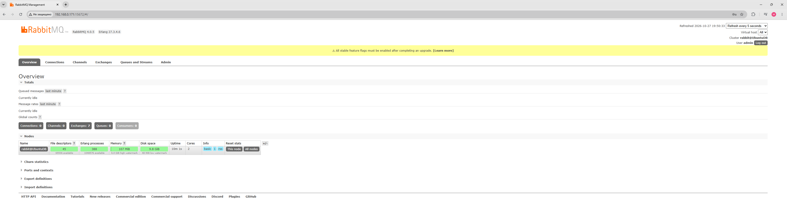
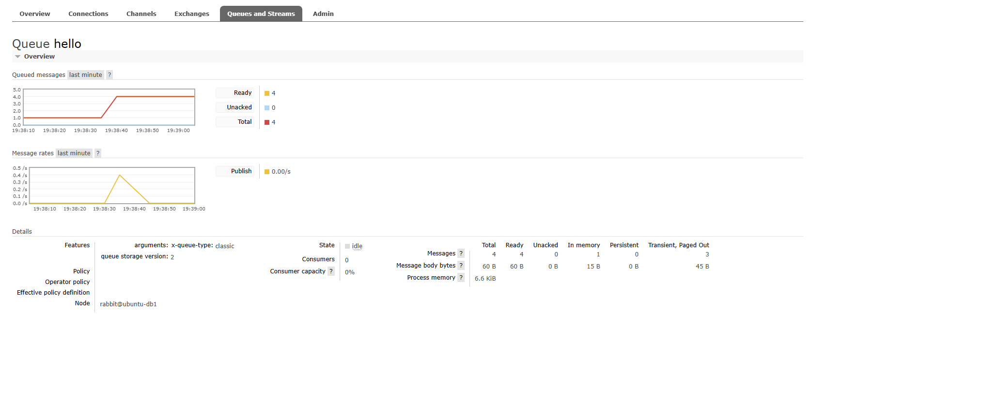
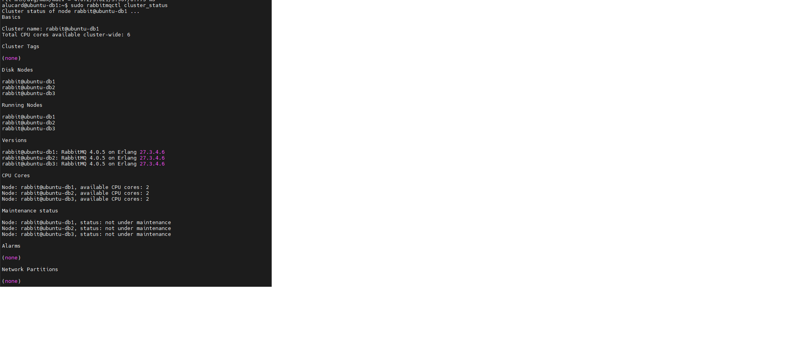
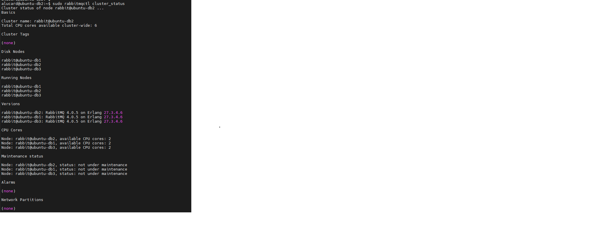
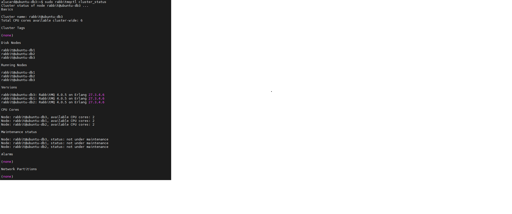
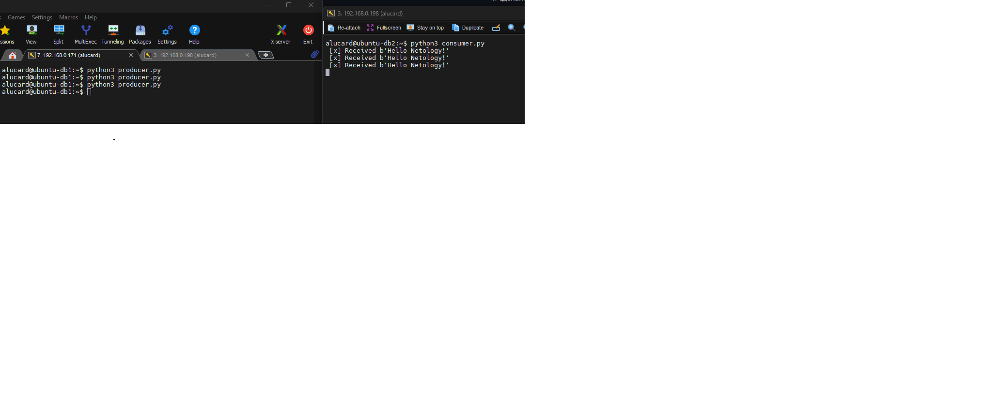

# Домашнее задание к занятию "`Очереди RabbitMQ`" - `Смирнов Михаил`

### Задание 1. Установка RabbitMQ

---

### Задание 2. Отправка и получение сообщений

---

### Задание 3. Подготовка HA кластера

